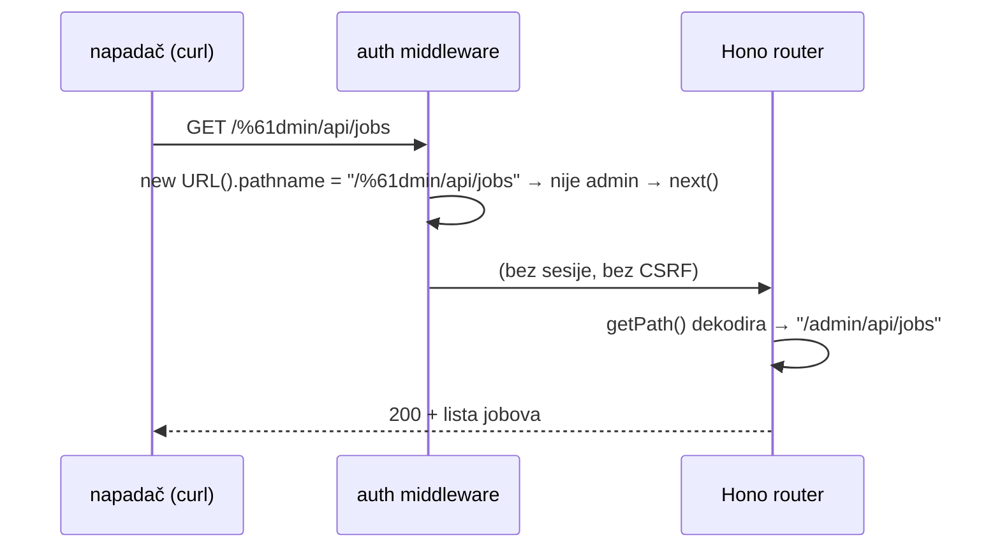

# Incident 14./15.10.2026. — zaobilazak admin prijave preko `/%61dmin/`

Cijeli postmortem (uzrok, pay šteta, pouke) je u pay repou:
`docs/postmortems/0002-admin-auth-bypass-percent-encoded-path.md` (za sada na grani
`chore/opensaas-sandbox-tenant`, na `main` stiže spajanjem). Ovdje samo pipeline strana i
kako se istraga radila, da se ne otkriva ponovno.

## Ukratko

- 14.10. 22:25–23:29 UTC, IP `77.91.100.31` (UOWH LLC, Amsterdam), `curl/8.5.0`.
- Middleware u `backend/src/admin/auth/mount.ts` gledao je `new URL(c.req.url).pathname`
  (ostaje `/%61dmin/…`), a Hono router putanju dekodira → admin rute bez sesije i bez
  Origin provjere. Fix `96fef04`: sve na `c.req.path`, enkodirana admin putanja → 400
  (`admin_encoded_path_rejected` u logu).
- Prvi zahtjev uopće bio je `GET pipeline.domovina.ai/` (JSON s popisom ruta), 7 min
  kasnije `mpt.domovina.ai/`. Repo je javan, `docs/admin-auth.md` imenuje pay i mpt —
  vjerojatan put. Dan prije projekt je spomenut u Telegram grupi.

## Pipeline šteta i čišćenje (15.10.)

| Što | Čišćenje |
|---|---|
| API ključ `artex_poc_2026` (id `6d368e3d-…`), napravljen 23:09:25 | `enabled=0, credits=0` |
| 26 jobova (fuzz naslovi `$(id)`, `` `id` ``, `../../../../etc/passwd`, `artex4345_*`, lažni X URL-ovi `x.com/artexu/…`) | soft-delete, `state=failed`, napomena u `error` |
| Čitano: `/admin/api/jobs`, `/discovered`, `/keys` (bez sirovih ključeva), pipeline/files dva joba | — |

Bridge je neke od tih jobova pokupio (download pao — videi ne postoje). Naslovi nisu
opasni za bridge: `spawnSync` s nizom argumenata, bez shella.

## Kako se istraga radila (zamke)

- **Worker logovi**: wrangler OAuth token nema observability scope (`Authentication error`).
  Radi iz Brave taba na `dash.cloudflare.com/…/workers/services/view/<worker>/production/observability/events`:
  presretni `fetch` stranice, promijeni vremenski raspon (UI pošalje `telemetry/query`) i
  uzmi njegova zaglavlja (`x-atok`, `workers-observability-origin`). S `x-cross-site-security: dash`
  isti POST vrati 403 HTML.
- **Server-side filter po headeru ili `includes '%'` nije pouzdan** (vratio 0 / 1 iako
  pogodaka ima stotine). Povlači se po vremenskim odsječcima (10–15 min, `limit: 2000`)
  i filtrira u pregledniku po `$workers.event.request.headers['cf-connecting-ip']`.
- Cloudflare u `path` zamjenjuje UUID-ove s `REDACTED`; ID-eve traži u D1 po vremenu.
- `admin_sessions` nije pomogao: napadač sesiju nije ni imao.
- Pay audit log: svaki zapis s `actor='admin:unknown'` znači akciju bez sesije.

## Pregled ostalih admina (15.10.)

| Host | Stanje |
|---|---|
| `pipeline.domovina.ai` | ranjiv → popravljeno `96fef04` |
| `mpt.domovina.ai` (pay) | ranjiv → popravljeno `0e7ceeb` |
| `bank-push-gateway.domovina.ai` | nije iskoristiv (dispatch na sirovom `/admin`, deny-by-default) → svejedno otvrdnut `794d4dd` |
| `omm.domovina.ai` (Astro) | nije ranjiv: Astro middlewareu daje već dekodiran `url`, isti koji koristi za routing (`/%61dmin/passkeys` → login) |
| Access-only aplikacije (Grafana, studio, `api.domovina.ai/dashboard*`…) | Access na rubu hvata i enkodirane putanje (`/d%61shboard` → Access login) |

## Otvoreno

- Obavijest ITalku / korisnicima za podatke pročitane iz pay admina — odluka vlasnika.
- Alarm na `admin_encoded_path_rejected` i na `admin:unknown` u pay audit logu.
- Postmortem 0002 na pay `main` (spajanjem opensaas grane ili zasebno).
