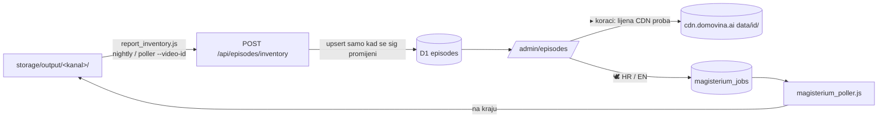

# Inventar epizoda — /admin/episodes (v0.21.0, 21.10.2026.)

Jedno mjesto gdje se vide **sve** epizode na disku Mac Minija (svi praćeni kanali, uključujući
EN: catholic_futurist, subclub, launched) i dokle je koja stigla po koraku. Control plane je
pipeline.domovina.ai; podcast.domovina.ai ostaje javni read-only HR katalog.

## Dijelovi

- **`episodes`** (migracija 0014): youtube_id PK, bez FK na jobs. Stupac po koraku s vrijednošću
  `ok | missing | partial | blocked | na`; `transcript` = `speechmatics | canary | none`;
  `article_model`/`article_date` iz imena najnovijeg članka.
- **`bridge/report_inventory.js`**: cijeli `storage/output` osim `sabor`, `_webpbackfill`. Nula LLM
  poziva. ~3.4k epizoda za ~16 s (vanjski disk). `--dry-run [--verbose]`, `--channel`, `--video-id`.
- **Upsert sa `sig`**: nightly šalje cijeli katalog, ali `ON CONFLICT … WHERE sig IS NOT excluded.sig`
  piše samo promijenjene retke (drugi run = 0 pisanja). Promjena stanja poništi `cdn` (proba zastarjela).
- **CDN se ne skenira s Maca** (R2 LIST-once pravilo). Kad se u adminu otvori „▸ koraci", Worker
  probe-a artefakte (`buildPipelineReport`) i upiše `cdn = ok|partial|missing` u redak.
- **Detail redak** koristi dijeljeni klijent (`ui/client.ts`) s `READ='/admin/api/ep'` → rute
  `/admin/api/ep/jobs/:youtube_id/{pipeline,files}` (`:id` je youtube_id, epizoda nema job).
- **⏳**: Magisterium zahtjev queued/running, ili aktivan job za taj video (korelirani subupiti, samo
  za stranicu).

## Pravila izvođenja stanja (s diska)

| korak | ok kad postoji (iza `_yt_<id>`) | ostalo |
|---|---|---|
| fetch | `.info.json` | `partial` = samo media |
| transcript | `.mp3.speechmatics*.srt` → speechmatics, inače `.wav.canary.srt` → canary | `none` |
| diarized | `.wav.canary.diarized.srt` / `.mp3.speechmatics[.gemini].diarized.srt` | |
| summary | `.wav.canary.summary.json` | `blocked` = `.wav.canary.summary.blocked.json` |
| article | najnoviji `.wav.canary.diarized_{datum}_{model}.article.json` | `partial` < 2000 B (krnji); `blocked` = `.wav.canary.diarized.blocked.json` |
| magisterium_hr / _en / article_en | `{najnoviji članak}.article.magisterium[.en].json` / `.article.en.json` | `partial` = postoji samo uz STARIJI članak |
| screenshots | `_screenshots` | `na` = audio-only (`_yt_matched === false`) |
| words | `.words.json` | `na` = `.words.skipped.json` |
| rag / epub | `.rag_combined.jsonl` / `.epub` | |

Isti `_unlisted` + kanal duplikat → pobjeđuje pravi kanal. Sadržaj članka (iteracije vs outline)
i dalje validira `fetch.domovina.tv/audit_pipeline.js`; ovdje je samo heuristika po veličini.

## 🕊 akcije

`POST /admin/episodes/:id/magisterium-hr|-en` → `enqueueMagisteriumJob`. HR samo uz `article=ok`,
EN samo uz `magisterium_hr=ok` (server i UI). `partial` → `force=1` (regeneriraj nad novim člankom).

## Otkriveni videi (fix uz ovo)

`promoteDiscovered` za red čiji `stage` nije `fetched` više ne stvara puni single-video job:
video je već u kanalu, a download u `_unlisted` padne („nema info.json u _unlisted", nuNw4qWs0r4,
job `25f63195…`). UI umjesto ⚡ nudi „📚 u inventaru". Otvoreno: pada li puni job i za `fetched`.

## Ožičenje

- `priority_poller.js` i `magisterium_poller.js` na kraju svakog joba pozovu
  `report_inventory.js --video-id <id>` (best-effort).
- Nightly (`fetch.domovina.tv/automatic/nightly_pipeline.sh`, uz `report_discovered.js`): **čeka OK**.

## Faza 3 / 4 (nije napravljeno)

- 3: „samo što fali" — batch akcije po filteru (npr. svi kojima fali Magisterium HR u kanalu X),
  reprocess koraka bez punog joba (EN članak, words, epub).
- 4: kandidati iz podcast.domovina.ai → „počni pratiti" kanal.
