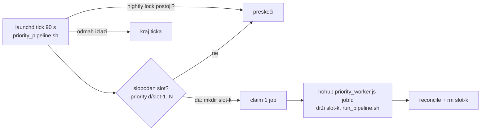

# Paralelna obrada više videa — analiza lockova i prijedlog (27.10.2026.)

Povod: Mag EN za `nuNw4qWs0r4` preveden je u 134 s, a zatim 30 min čeka dijeljeni pipeline
lock jer prioritetni run za `nBPDxzrAW0Q` (1 h 47 min audija) drži lock cijelim trajanjem.
Pitanje: koji su lockovi stvarno potrebni i kako pustiti više videa istovremeno.

## Stanje: faze A, B i C implementirane 27.10.2026. (fetch.domovina.tv)

- **A**: `automatic/with_pipeline_lock.sh` uzima `logs/.publish.lock.d` (prvo publish, pa provjera
  globalnog locka); nightly KORAK 2+3 (channel index + meta upload) i `auto_reuse_adhoc.js` reindex
  idu kroz njega. Nightly izvozi `PIPELINE_GLOBAL_HOLDER=$$` da njegova djeca (auto_reuse --sweep)
  ne čekaju sama sebe. `pipeline_lock.sh`: prazan pid u direktoriju mlađem od 30 s = zauzet
  (prije bi ga drugi proces proglasio stale i obrisao).
- **B**: `lib/atomic_json.js` (`writeFileAtomic`, `loadDoneState`/`saveDoneState` — disk ∪ vlastiti
  novi unosi, da reprocess brisanje ne oživi) u summarize/article/rag ×3; R2 keys/MD5 cache i bundle
  state spajaju se s diskom; channel index i `force_upload_epubs` pišu atomski; `--video-id` u
  `generate_og_image.js` i `generate_og_sections.py`, a fast-path za sva tri slikovna koraka šalje
  `PRIORITY_SCOPE_ARGS`.
- **C**: `priority_pipeline.sh` je dispatcher, `priority_worker.sh` jedan slot (`logs/.priority.d/slot-N`,
  log redci s prefiksom `[sN]`). `PRIORITY_SLOTS` (2), `PRIORITY_MIN_FREE_GB` (25 — samo za slot 2+).
  Plist ima `AbandonProcessGroup`; worker je i u vlastitoj sesiji (`perl POSIX::setsid`). Nightly
  nakon globalnog locka čeka žive slotove i objavu (`NIGHTLY_SLOT_WAIT_S`, 3 h).
- Na dan uvođenja disk je bio 98 % pun (11–12 GB slobodno) → radi samo slot 1 dok se ne oslobodi
  ≥25 GB. Faza D (Magisterium EN zasebna traka) nije rađena.

## 1. Što je postojalo prije (analiza)

| Lock | Tko ga uzima | Koliko dugo | Što štiti (namjera) |
|---|---|---|---|
| `automatic/logs/.pipeline.lock.d` | nightly (`wait`), priority tick (`nowait` → preskoči tick), `with_pipeline_lock.sh` (Magisterium objava, reels objava; čeka 30 / 10 min) | nightly 40–75 min; priority **cijeli run** (30–60 min po videu, × do 3 videa po ticku) | sve: channel index, state fajlove, R2 cache, disk/RAM |
| `.magisterium.lock.d` | magisterium tick | cijeli tick | jedan Magisterium run (MCP chat 15 req/min) |
| `.nightly.lock` | nightly | cijeli nightly | dva nightlyja |
| launchd single-instance | svaki plist | dok skripta živi | dok `priority_pipeline.sh` radi, launchd ne pali novi tick |

Posljedica: **cijeli stroj ima jedan "radnik" za prioritetne videe.** `priority_poller.js` claima
do 3 joba i vrti ih `spawnSync` jedan za drugim; sve ostalo (Magisterium objava, reels objava)
čeka iza njega ili pada nakon timeouta (exit 75).

Povijest: lock je uveden 07.07. (`b87662a9`) kao jednostavan mutex nightly ↔ priority. 19.10.
(`6e687cd2`) Magisterium je dobio vlastiti lock, a dijeljeni uzima samo za objavu — jer je
tick preskakao satima dok je playlista išla kroz prioritetni red.

## 2. Gdje run stvarno troši vrijeme (nBPDxzrAW0Q, 27.10.)

```
12:23:42  KORAK 1   yt-dlp                     0:33
12:24:19  KORAK 2.6 Modal Canary               1:54   (cloud)
12:26:13  KORAK 2.7b Soniox                    3:23   (cloud)
12:29:36  KORAK 2.7c pyannoteAI                1:03   (cloud)
12:30:39  KORAK 2.8 Gemini sluh               14:48   (cloud)
12:45:27  KORAK 6   lokalna diarizacija        0:00   (preskočeno — kostur već postoji)
12:45:27  KORAK 7   sažetak                    0:34   (cloud)
12:46:01  KORAK 8   članak (claude -p opus)   ~15+    (cloud / pretplata)
          KORAK 9–12.7 slike, ffmpeg h264, R2   lokalno CPU + mreža
```

**~90 % vremena run čeka vanjski API.** Lokalni stroj (M4 Pro, 24 GB) je za to vrijeme gotovo
neopterećen. Lokalni teški dijelovi su kratki: WAV konverzija, screenshotovi, H.264 encode,
OG slike. Lokalna pyannote diarizacija (~3 GB po workeru, OOM incident 31.07.) s novim cloud
putem (Soniox + pyannoteAI) se u fast-pathu preskače.

## 3. Što je stvarno dijeljeno stanje (i je li opasno)

Fast-path (`--modal-only <id>`) je već skoro posve scope-an na jedan video
(`PRIORITY_SCOPE_ARGS`) i **preskače KORAK 13 (channel index)**. Ostaje:

| Dijeljeni resurs | Gdje | Rizik kod 2 paralelna runa | Težina |
|---|---|---|---|
| `storage/meta/*.json` (channel index) + `upload_to_r2 --meta-dir` | nightly KORAK 13, `auto_reuse_adhoc.js` (reindex SVIH kanala kad nešto kopira), Magisterium objava (`--channel X`) | `generate_channel_index.js` piše `writeFileSync` (ne atomski) → paralelni meta upload može objaviti napola zapisan JSON → pokvaren indeks kanala na CDN-u | **stvaran — ovo je jedini pravi razlog za lock** |
| `articles-done.json`, `summarize-done.json` | `saveDoneState` u `generate_article_gemini.js:996`, `summarize_gemini.js:1103` | isti `.tmp` naziv za oba procesa → drugi `renameSync` baci ENOENT **nakon** što je članak zapisan (crash skripte); lost update samo briše zapis iz cachea (provjera postojanja fajla na L1639 ga uhvati) | srednje, trivijalan fix |
| `.r2_keys_cache.json` (190k ključeva), MD5 cache | `upload_to_r2.js:291,357` | ne-atomski write + lost update → cache se tretira kao prazan / fale ključevi → ponovni upload (sporo, ali ispravno) | nisko |
| episode bundle state | `build_episode_bundle.js:218` | lost update, "nije kritično" | nisko |
| `_unlisted` koraci scope-ani samo po kanalu | `generate_og_image.js`, `generate_webp_thumbs.js`, `generate_og_sections.py` (`PRIORITY_CHANNEL_ARGS`) | oba runa prolaze cijeli `_unlisted`; ako nekom trećem videu fali slika, oba je generiraju u isti fajl | nisko (većinom skip) |
| Claude pretplata | KORAK 8 (opus, outline + N iteracija) | 2 runa = 2× brža potrošnja prozora; `CLAUDE_WINDOW_GUARD` i dalje vrijedi | **budžetno** |
| YouTube anti-bot | KORAK 1, KORAK 10 | paralelni yt-dlp povećava rizik 403 | nisko kod N=2 |
| RAM / disk | H.264, screenshotovi, WAV | 2–3 runa stanu; disk-guard prije starta (incident pun disk) | nisko kod N≤3 |
| Magisterium API (15 req/min) | samo HR (MCP) | EN je Gemini prijevod — **ne dira Magisterium API** | — |

## 4. Prijedlog (po fazama, svaka zasebno korisna)

### Faza A — uski "publish" lock umjesto dijeljenog (najveći dobitak, mali rizik)

- Novi `logs/.publish.lock.d`: drži se **samo** oko `generate_channel_index.js` + `upload_to_r2 --meta-dir`
  (sekunde, ne sate). Uzimaju ga: nightly KORAK 13, `auto_reuse_adhoc.js` reindex,
  Magisterium objava, reels objava.
- `with_pipeline_lock.sh` za Magisterium/reels prebaciti na publish lock; per-video R2 upload
  ide bez locka (cache je samo optimizacija, vidi fazu B).
- Magisterium tick i dalje preskače za vrijeme nightlyja (nightly je jedini koji legitimno
  prepisuje velik dio stabla).
- Rezultat: Mag EN/HR i reels objavljuju se odmah, bez obzira na prioritetni run. Nema više
  exit 75 "lock nije dobiven u 30 min".

### Faza B — učvrstiti dijeljene fajlove (preduvjet za fazu C)

- Jedan helper `writeJsonAtomic(path, data)` = `path.tmp.<pid>` + `renameSync`; koristiti u
  `saveDoneState` (oba), `upload_to_r2` cache, `build_episode_bundle` state,
  `generate_channel_index.writeJson`.
- R2 keys/MD5 cache: na save ponovno pročitaj, napravi uniju, pa atomski zapiši (nema lost
  updatea, a ključevi se samo dodaju).
- `--video-id` u `generate_og_image.js`, `generate_webp_thumbs.js`, `generate_og_sections.py`
  i prebaciti ih s `PRIORITY_CHANNEL_ARGS` na `PRIORITY_SCOPE_ARGS`.

### Faza C — N prioritetnih slotova (stvarna paralelnost)

Zamka: launchd ne pokreće novi tick dok stari živi, pa "dva ticka" ne mogu ići paralelno.
Zato **dispatcher + detached worker**:



- Tick: ako postoji nightly lock → izlaz. Inače za svaki slobodan slot (`mkdir slot-k`, pid u
  njemu, stale detekcija kao u `pipeline_lock.sh`) claima **1** job i pokrene detached worker,
  pa izlazi. Sljedeći tick za 90 s puni preostale slotove.
- Plist `tv.domovina.fetch.priority`: `AbandonProcessGroup = true`, inače launchd ubije
  workere čim tick izađe.
- Nightly: `mkdir .pipeline.lock.d` (namjera), pa čeka da nestanu živi slotovi; novi slotovi
  se ne otvaraju dok lock postoji (reader/writer preko mkdira).
- Dnevni budžet (`PRIORITY_DAILY_MAX`) i atomski claim u D1 ostaju — isti job ne može u dva slota.
- Prije otvaranja slota: disk-guard (slobodno > X GB) i postojeći `CLAUDE_WINDOW_GUARD`.
- `PRIORITY_SLOTS=2` za početak; 3 tek nakon mjerenja Claude prozora.

Procjena: playlista od 12 videa po ~40 min — danas ~8 h serijski; 2 slota ~4 h; 3 slota ~2,7 h
(gornja granica je Claude pretplata za KORAK 8, ne stroj).

### Faza D — Magisterium EN odvojen od HR (opcionalno)

EN je čisti Gemini prijevod (bez Magisterium API-ja i bez Claudea od v0.21.2), pa ne treba
stajati iza HR runa na `.magisterium.lock.d`. Druga traka (`.magisterium-en.lock.d`) ili EN
odmah u istom ticku nakon HR claima.

## 5. Usput nađeno

- **Zapeli `processing` nakon ponovne obrade**: job s `redo_article=1` ne dobije
  `--reprocess-article` u fetch argumentima → članak se preskoči (done cache) → `reconcile.js`
  čeka članak noviji od joba zauvijek (nuNw4qWs0r4, 24.–27.10., ~3000 "ostaje processing").
- `magisterium_jobs` NamKWyUNrbU HR `running` od 23.09. (nema stuck sweepa).

## Redoslijed

A → B → C, svaki korak zaseban commit i jedan dan promatranja. A sam rješava današnji
simptom (Magisterium/reels čekaju prioritetni run). C ima smisla tek nakon B.
